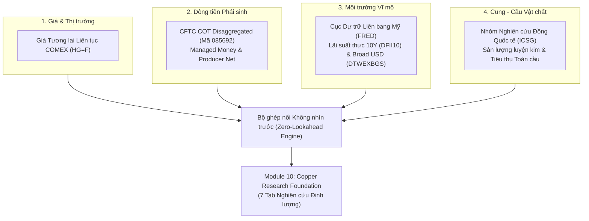
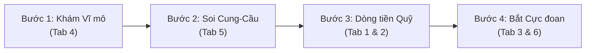

# HƯỚNG DẪN SỬ DỤNG CHI TIẾT
# PHÂN HỆ NGHIÊN CỨU ĐỒNG TOÀN CẦU (COPPER RESEARCH FOUNDATION)
### Nền tảng Tình báo Hàng hóa Toàn cầu (Global Commodity Intelligence Platform)

---

## MỤC LỤC
1. [Giới thiệu Dễ hiểu cho Người Mới](#1-giới-thiệu-dễ-hiểu-cho-người-mới)
2. [Bốn Lớp Dữ liệu Cốt lõi của Nền tảng](#2-bốn-lớp-dữ-liệu-cốt-lõi-của-nền-tảng)
3. [Cách Khởi chạy và Truy cập Ứng dụng](#3-cách-khởi-chạy-và-truy-cập-ứng-dụng)
4. [Hướng dẫn Chi tiết Từng Tab Chức năng (Tab 1 – Tab 7)](#4-hướng-dẫn-chi-tiết-từng-tab-chức-năng)
   - [Tab 1: Bức tranh Toàn cảnh Thị trường (Market Overview)](#tab-1-bức-tranh-toàn-cảnh-thị-trường-market-overview)
   - [Tab 2: Khám phá Tương quan Giá & Dòng tiền (Price & Positioning)](#tab-2-khám-phá-tương-quan-giá--dòng-tiền-price--positioning)
   - [Tab 3: Đo lường Tâm lý Đám đông & Điểm Cực đoan (Positioning Dynamics)](#tab-3-đo-lường-tâm-lý-đám-đông--điểm-cực-đoan-positioning-dynamics)
   - [Tab 4: Tác động của Vĩ mô Toàn cầu (Macro Dynamics - FRED)](#tab-4-tác-động-của-vĩ-mô-toàn-cầu-macro-dynamics---fred)
   - [Tab 5: Cung - Cầu Vật chất Thực tế Thế giới (Physical Fundamentals - ICSG)](#tab-5-cung---cầu-vật-chất-thực-tế-thế-giới-physical-fundamentals---icsg)
   - [Tab 6: Phòng Thí nghiệm Quan hệ Nhân Quả (Relationship Lab)](#tab-6-phòng-thí-nghiệm-quan-hệ-nhân-quả-relationship-lab)
   - [Tab 7: Bản tin Nghiên cứu Điều hành (Research Briefing)](#tab-7-bản-tin-nghiên-cứu-điều-hành-research-briefing)
5. [Quy trình 4 Bước Phân tích Thị trường Thực tế cho Người Mới](#5-quy-trình-4-bước-phân-tích-thị-trường-thực-tế)
6. [Bảng Tra cứu Thuật ngữ Cần biết](#6-bảng-tra-cứu-thuật-ngữ-cần-biết)

---

## 1. GIỚI THIỆU DỄ HIỂU CHO NGƯỜI MỚI

### Kim loại Đồng (Copper) là gì trong giới tài chính?
Trong thị trường tài chính quốc tế, Đồng được mệnh danh là **"Tiến sĩ Đồng" (Dr. Copper)**. Sở dĩ có tên gọi này vì Đồng hiện diện trong mọi ngành công nghiệp: lưới điện, vi mạch bán dẫn, xe điện, pin năng lượng mặt trời, xây dựng và giao thông. Khi kinh tế thế giới tăng trưởng mạnh, nhu cầu mua đồng tăng vọt khiến giá tăng. Khi kinh tế suy thoái, giá đồng giảm trước cả khi thị trường chứng khoán kịp nhận ra. Do đó, nghiên cứu Đồng giúp bạn nắm bắt được "nhịp tim" của toàn bộ kinh tế thế giới.

### Tại sao không thể "chỉ nhìn mỗi báo cáo COT"?
- **Báo cáo COT (Commitments of Traders)** chỉ cho bạn biết: Các quỹ đầu cơ tại Mỹ (sàn COMEX) đang mua hay bán bao nhiêu hợp đồng giấy.
- **Vấn đề là:** Nếu chỉ nhìn COT, bạn giống như một người lái xe chỉ nhìn vào gương chiếu hậu. Bạn thấy quỹ đang bán ròng, nhưng bạn **không biết vì sao họ bán**:
  - Do lãi suất của Fed tăng cao khiến chi phí giữ hàng quá đắt?
  - Do đồng USD quá mạnh đè bẹp giá hàng hóa?
  - Hay do các mỏ đồng ở Chile và Peru vừa đào được quá nhiều quặng gây thừa ứ trên toàn cầu?
- **Phiên bản mới này giải quyết triệt để vấn đề đó:** Nó kết hợp dòng tiền đầu cơ với giá cả thực tế, môi trường vĩ mô và cân đối cung cầu vật chất toàn cầu.

---

## 2. BỐN LỚP DỮ LIỆU CỐT LÕI CỦA NỀN TẢNG

Nền tảng liên kết 4 lớp dữ liệu độc lập thành một hệ thống duy nhất:



1. **Lớp 1 — Giá cả (Price):** Giá hợp đồng tương lai liên tục của đồng loại 1 trên sàn COMEX (USD / pound).
2. **Lớp 2 — Vị thế dòng tiền (COT):** Phân loại rõ ràng giữa **Managed Money** (quỹ phòng hộ/đầu cơ theo xu hướng) và **Producer/Merchant** (các công ty khai khoáng, nhà máy đúc đồng bán bảo hộ hàng tồn kho).
3. **Lớp 3 — Vĩ mô toàn cầu (FRED):** 
   - Lãi suất thực 10 năm của Mỹ (`DFII10`): Đo lường chi phí vốn cơ hội. Lãi suất thực tăng $\rightarrow$ nắm giữ tài sản vật chất không sinh lãi trở nên kém hấp dẫn.
   - Chỉ số USD Thương mại mở rộng (`DTWEXBGS`): Đo sức mạnh đồng USD so với các đối tác thương mại lớn của Mỹ (bao gồm cả các nước đang phát triển).
4. **Lớp 4 — Cung cầu vật chất thế giới (ICSG):** Số liệu chính thức từ International Copper Study Group đo lường thế giới đang thừa (Surplus) hay thiếu hụt (Deficit) bao nhiêu nghìn tấn đồng tinh luyện mỗi năm.

---

## 3. CÁCH KHỞI CHẠY VÀ TRUY CẬP ỨNG DỤNG

### Bước 1: Mở ứng dụng
Mở terminal trên máy trạm và chạy lệnh sau (hoặc click chạy file `start.bat`):
```powershell
cd E:\My\the20\cot_research_lab_deploy
E:\My\the20\test_strategy\commodity_source\cot_analyze\.venv\Scripts\streamlit.exe run run_research_lab.py --server.port 8501 --server.address 127.0.0.1
```

### Bước 2: Truy cập trình duyệt
Mở trình duyệt Google Chrome, Edge hoặc Firefox và gõ địa chỉ:  
👉 [**http://localhost:8501**](http://localhost:8501)

### Bước 3: Điều hướng đến Module 10
Tại thanh menu bên trái (Sidebar):
1. **Navigation:** Chọn dòng cuối cùng `10. Copper Research Foundation`.
2. **Report Family:** Đảm bảo đang chọn `Disaggregated COT (Primary - Commodities)`.
3. **Commodity Selection:** Đảm bảo đang chọn `Copper`.

---

## 4. HƯỚNG DẪN CHI TIẾT TỪNG TAB CHỨC NĂNG

### Tab 1: Bức tranh Toàn cảnh Thị trường (Market Overview)

Đây là "bảng đồng hồ táp-lô" (dashboard) giúp bạn nắm bắt ngay lập tức trạng thái của toàn bộ thị trường trong 10 giây.

#### Ý nghĩa 8 thẻ thông số (Metric Cards):
1. **COMEX Copper Price ($/lb):** Giá 1 pound đồng trên sàn COMEX (khoảng $6.53/lb). Kèm theo mức tăng/giảm % so với tuần trước (WoW).
2. **Managed Money Net (Hợp đồng):** Vị thế ròng của các quỹ đầu cơ lớn (Vị thế Mua trừ Vị thế Bán).
   - *Nếu dương (+):* Quỹ đang cược giá đồng đi lên.
   - *Nếu âm (-):* Quỹ đang cược giá đồng giảm xuống.
   - *Phần trăm trong ngoặc (% of OI):* Tỷ trọng vị thế ròng so với tổng quy mô thị trường (ví dụ: `+11.5% of OI`).
3. **Producer / Merchant Net (Hợp đồng):** Vị thế ròng của các nhà sản xuất/khai thác mỏ.
   - Con số này **hầu như luôn luôn âm (-)** vì các công ty khai thác mỏ luôn bán khống hợp đồng tương lai để chốt trước giá bán cho lượng quặng họ sắp đào lên (Hedging).
   - *Kinh nghiệm đọc:* Khi chỉ số này bớt âm (tiến về 0), tức là các mỏ từ chối bán khống vì giá đồng đang quá rẻ $\rightarrow$ Thị trường đang tạo đáy!
4. **US 10Y Real Yield (FRED) (%):** Lãi suất thực trái phiếu chính phủ Mỹ 10 năm. Lãi suất thực tăng thường tạo áp lực đè nặng lên giá kim loại.
5. **Broad USD Index (FRED):** Sức mạnh đồng USD. Đồng USD mạnh lên làm giá đồng (tính bằng USD) trở nên đắt đỏ hơn đối với các khách hàng quốc tế.
6. **ICSG Apparent Balance (kt):** Thặng dư (+) hoặc Thâm hụt (-) của thị trường đồng tinh luyện toàn cầu tính bằng nghìn tấn (kt).
7. **Market Open Interest (ctrs):** Tổng số hợp đồng phái sinh đang lưu hành trên thị trường. Đo lường độ thanh khoản và sự quan tâm của thị trường.
8. **As-Of Date:** Ngày chốt dữ liệu báo cáo (thứ Ba khảo sát, neo giá thứ Sáu công bố).

---

### Tab 2: Khám phá Tương quan Giá & Dòng tiền (Price & Positioning)

Tab này cung cấp biểu đồ tương tác 3 tầng được đồng bộ hóa hoàn toàn trên cùng một trục thời gian (từ 2018 đến nay):

- **Tầng A (Trên cùng - Màu vàng): Biểu đồ Giá Đồng COMEX ($/lb)**
  Cho bạn thấy xu hướng giá cả theo thời gian.
- **Tầng B (Ở giữa): Số lượng Hợp đồng Vị thế Ròng**
  - *Đường màu xanh lá (Managed Money):* Vị thế ròng của quỹ đầu cơ.
  - *Đường màu đỏ (Producer/Merchant):* Vị thế bán bảo hiểm của các mỏ khai thác.
  - *Đường đứt nét xám ở giữa ($y=0$):* Ranh giới phân chia giữa Mua ròng (trên 0) và Bán ròng (dưới 0).
- **Tầng C (Dưới cùng): Tỷ lệ Net % of Open Interest**
  Chuẩn hóa vị thế ròng theo phần trăm quy mô thị trường để tránh bị sai lệch khi thị trường tăng trưởng quy mô theo năm tháng.

> [!TIP]
> **Cách đọc quy luật Dòng tiền & Giá (Lead-Lag Insights):**
> - **Tiếp diễn xu hướng (Trend Continuation):** Giá phá đỉnh mới đồng thời đường Managed Money dốc đứng đi lên và Producer ngày càng bán khống sâu $\rightarrow$ Dòng tiền đầu cơ đang hỗ trợ mạnh mẽ xu hướng tăng.
> - **Phân kỳ đảo chiều (Divergence Exhaustion):** Giá đồng rướn lên lập đỉnh mới, nhưng đường Managed Money Net lại đạt đỉnh trước đó rồi bắt đầu dốc xuống $\rightarrow$ Quỹ đầu cơ đang bí mật chốt lời rút quân, cảnh báo nguy cơ đảo chiều giảm!

---

### Tab 3: Đo lường Tâm lý Đám đông & Điểm Cực đoan (Positioning Dynamics)

Tại đây bạn sẽ biết được: **Đám đông đầu cơ đang hưng phấn đến mức nào, hay họ đã bán tháo sạch sẽ?**

#### 1. Bộ chọn chu kỳ lịch sử (Dropdown):
Bạn có thể chọn đối chiếu mức độ cực đoan so với:
- `52 Weeks (1.0 Years)`: Chu kỳ ngắn hạn 1 năm.
- `104 Weeks (2.0 Years)`: Chu kỳ trung hạn 2 năm.
- `156 Weeks (3.0 Years)`: Chu kỳ 3 năm.
- `260 Weeks (5.0 Years)`: Chu kỳ vĩ mô dài hạn 5 năm.

#### 2. Biểu đồ Rolling Z-Score (Độ lệch chuẩn):
- Đường nằm giữa ($0\sigma$): Mức vị thế trung bình của các quỹ.
- **Vạch đỏ đứt nét ($+2.0\sigma$ - Extreme Bullish Crowding):** Báo động đỏ! Các quỹ đầu cơ đã mua quá nhiều, vị thế quá đông đúc (Crowded Long). Khi ai cũng đã mua rồi thì không còn người mua mới nữa $\rightarrow$ Nguy cơ cao xuất hiện đợt bán tháo thanh lý vị thế.
- **Vạch xanh đứt nét ($-2.0\sigma$ - Extreme Bearish Exhaustion):** Vị thế bán khống của các quỹ đã cạn kiệt đà (Exhaustion Short). Thị trường rơi vào vùng quá bán sâu $\rightarrow$ Cơ hội lớn giá đồng sắp phục hồi mạnh.

#### 3. Biểu đồ Percentile Rank (%):
Quy đổi vị thế về thang điểm từ $0\%$ đến $100\%$:
- Trên $90\%$: Vùng đỉnh hưng phấn cực đại.
- Dưới $10\%$: Vùng đáy hoảng loạn cùng cực.

---

### Tab 4: Tác động của Vĩ mô Toàn cầu (Macro Dynamics - FRED)

Đồng không thể tăng giá nếu vĩ mô chống lại nó. Tab 4 cung cấp cái nhìn đối sánh trực tiếp giữa Đồng và 2 nhân tố vĩ mô quyền lực nhất:

1. **Biểu đồ Giá Đồng vs Lãi suất thực Mỹ 10Y (US 10Y Real Yield):**
   - Lãi suất thực = Lãi suất danh nghĩa trừ đi Lạm phát kỳ vọng.
   - Khi lãi suất thực âm hoặc rất thấp, tiền mặt mất giá, các tổ chức có xu hướng đổ tiền mua hàng hóa vật chất như Đồng để bảo vệ giá trị.
   - Khi lãi suất thực tăng vọt, giữ tiền mặt có lãi cao, chi phí tồn trữ đồng tăng $\rightarrow$ Giá đồng thường chịu áp lực giảm.
2. **Biểu đồ Giá Đồng vs Chỉ số USD Broad (`DTWEXBGS`):**
   - Cho thấy mối quan hệ nghịch chiều kinh điển giữa USD và Hàng hóa.
3. **Bốn chỉ số tương quan đo lường (Correlations):**
   - *Price vs Real Yield (Level):* Tương quan dài hạn giữa mặt bằng giá và mức lãi suất.
   - *Return vs $\Delta$Broad USD (Flow):* Tương quan ngắn hạn từng tuần. Con số âm lớn (ví dụ $r = -0.485$) chứng minh: Tuần nào USD tăng giá mạnh thì tuần đó giá đồng giảm mạnh và ngược lại!

---

### Tab 5: Cung - Cầu Vật chất Thực tế Thế giới (Physical Fundamentals - ICSG)

Đây là nơi đưa bạn trở về với thực tại sản xuất công nghiệp thực sự của thế giới, vượt ra ngoài các hợp đồng giấy trên sàn giao dịch.

#### 1. Bảng Dữ liệu Chuẩn hóa (Canonical Table):
Hiển thị số liệu từ **ICSG (International Copper Study Group)**:
- `mine_production`: Sản lượng đồng khai thác từ các mỏ quặng.
- `refined_production`: Sản lượng đồng tinh luyện đúc thành tấm/thỏi đưa ra thị trường.
- `refined_usage`: Tổng khối lượng đồng các nhà máy toàn cầu tiêu thụ.
- `publication_date` & `available_at`: **Độ trễ công bố thực tế.** Số liệu năm 2024 chỉ được phép hiển thị sau ngày công bố chính thức `2026-04-23`, tuyệt đối không có chuyện lấy số liệu tương lai gắn vào quá khứ.

#### 2. Biểu đồ Cân đối Cung Cầu:
- Cột xanh: Sản lượng tinh luyện thế giới.
- Cột đỏ: Nhu cầu tiêu thụ thế giới.
- Đường vàng (Apparent Balance): 
  - Nằm trên 0 $\rightarrow$ **Thị trường Thặng dư (Surplus)** (Đồng dư thừa, khó tăng giá mạnh).
  - Nằm dưới 0 $\rightarrow$ **Thị trường Thâm hụt (Deficit)** (Nhu cầu vượt sản xuất, báo hiệu thiếu hụt nguồn cung vật chất).

---

### Tab 6: Phòng Thí nghiệm Quan hệ Nhân Quả (Relationship Lab)

Đây là công cụ nghiên cứu khoa học mạnh mẽ nhất của hệ thống, giúp bạn tự tay trả lời câu hỏi: **"Biến số X có thực sự dẫn dắt biến số Y không?"**

#### Cách sử dụng 3 bước:
1. **Chọn biến độc lập (X):** Ví dụ chọn `Managed Money Net % of OI` (Tỷ lệ cược của quỹ).
2. **Chọn biến phụ thuộc (Y):** Ví dụ chọn `Weekly Copper Return (%)` (Tỷ suất sinh lợi giá đồng).
3. **Chọn độ trễ (Lag - Chu kỳ tuần):**
   - **Lag = 0:** Xem xét quan hệ đồng thời trong cùng 1 tuần.
   - **Lag = +1 (Khuyên dùng):** Biến X tuần trước ghép với biến Y tuần này. Tức là: *Hành vi mua bán của quỹ tuần trước có dự báo được giá đồng tăng hay giảm vào tuần này hay không?*
   - **Lag = +4:** Biến X dẫn dắt biến Y trước 1 tháng (4 tuần).
   - **Lag = -1:** Biến X đi sau biến Y.

#### Kết quả hiển thị:
- **Biểu đồ mây điểm (Scatter Plot):** Mỗi chấm tròn là một tuần giao dịch.
- **Đường xu hướng hồi quy OLS:** Độ dốc của đường thẳng cho biết mức độ nhạy cảm giữa 2 biến.
- **Hệ số tương quan Pearson ($r$):** Đo lường mối quan hệ tuyến tính thẳng.
- **Hệ số tương quan Spearman ($\rho$):** Đo lường mối quan hệ đơn điệu (X tăng thì Y có xu hướng tăng theo).
- **Cỡ mẫu ($N$):** Số lượng tuần giao dịch hợp lệ sau khi đã dịch chuyển độ trễ.

---

### Tab 7: Bản tin Nghiên cứu Điều hành (Research Briefing)

Tab này hoạt động như một chuyên viên phân tích định lượng ảo (Virtual Quant Analyst):
- Tự động quét toàn bộ 4 lớp dữ liệu của tuần giao dịch gần nhất.
- Tổng hợp thành một bản tin điều hành ngắn gọn 5 gạch đầu dòng bao gồm: Giá đóng cửa, Vị thế quỹ đầu cơ, Tình hình bán bảo hiểm của các mỏ, Lãi suất thực & Tỷ giá USD, và Cán cân cung cầu ICSG.
- Rất phù hợp để copy vào báo cáo tuần hoặc thuyết trình nội bộ.

---

## 5. QUY TRÌNH 4 BƯỚC PHÂN TÍCH THỊ TRƯỜNG THỰC TẾ

Khi bắt đầu nghiên cứu thị trường Đồng mỗi tuần, một nhà nghiên cứu chuyên nghiệp nên làm theo trình tự 4 bước sau:



### Bước 1: Khám Vĩ mô (Tab 4) — "Gió đang thổi chiều nào?"
- Kiểm tra Lãi suất thực 10Y và Chỉ số Broad USD.
- Nếu cả 2 chỉ số này đang giảm $\rightarrow$ Vĩ mô đang mở ra "cơn gió thuận" (Tailwind) cực mạnh cho kim loại tăng giá.

### Bước 2: Soi Cung - Cầu Vật chất (Tab 5) — "Nền tảng thực tế ra sao?"
- Nhìn vào cán cân ICSG Apparent Balance.
- Thị trường thế giới đang trong trạng thái thâm hụt (Deficit) hay thặng dư (Surplus)? Nếu thâm hụt, đà tăng giá có bệ đỡ vật chất vững chắc.

### Bước 3: Đọc Vị Vị thế Quỹ (Tab 1 & 2) — "Các tay chơi lớn đang làm gì?"
- Xem Managed Money Net % of OI đang dương hay âm và đang dốc lên hay dốc xuống.
- Nhìn Producer Net: Các công ty khai khoáng có đang gia tăng bán bảo hiểm không?

### Bước 4: Kiểm tra Điểm Cực đoan & Độ trễ (Tab 3 & 6) — "Có rủi ro đảo chiều không?"
- Mở Tab 3, kiểm tra Z-score 52W và 156W.
- Nếu Z-score đã vượt $+2.0\sigma$ (Percentile $>90\%$), hãy thận trọng: Dù tin tức tốt ngập tràn, thị trường đã quá đông đúc và dễ bị tổn thương trước một nhịp điều chỉnh xả hàng.

---

## 6. BẢNG TRA CỨU THUẬT NGỮ CẦN BIẾT

| Thuật ngữ | Tên tiếng Anh | Định nghĩa Dễ hiểu |
|---|---|---|
| **Managed Money** | Managed Money (Quỹ đầu cơ) | Các quỹ phòng hộ (Hedge Funds), quỹ CTA giao dịch theo xu hướng trên sàn phái sinh nhằm mục đích kiếm lợi nhuận từ chênh lệch giá. |
| **Producer / Merchant** | Producer / Merchant / Processor / User | Các đơn vị hoạt động trong chuỗi cung ứng thực tế (công ty khai khoáng, nhà máy luyện đồng, doanh nghiệp sản xuất dây cáp điện). Họ tham gia sàn chủ yếu để phòng vệ rủi ro biến động giá quặng. |
| **Open Interest (OI)** | Open Interest (Khối lượng mở) | Tổng số lượng hợp đồng phái sinh chưa tất toán đang lưu hành. Biểu thị quy mô thanh khoản của thị trường. |
| **Net Position** | Net Position (Vị thế Ròng) | Số hợp đồng Mua (Long) trừ đi số hợp đồng Bán (Short) của một nhóm đối tượng. Dương là mua ròng, âm là bán ròng. |
| **Net % of OI** | Net Positioning as % of Open Interest | Tỷ lệ vị thế ròng chia cho tổng khối lượng mở, nhân với 100%. Giúp so sánh sức mạnh dòng tiền qua nhiều năm một cách chuẩn mực. |
| **Z-Score ($\sigma$)** | Standardized Z-Score | Số đo độ lệch chuẩn so với giá trị trung bình trong quá khứ. $Z > +2$ là cực đại hưng phấn; $Z < -2$ là cực đại bi quan. |
| **Percentile Rank (%)** | Percentile Ranking | Vị trí phần trăm của giá trị hiện tại so với toàn bộ dữ liệu lịch sử trong cửa sổ đã chọn (từ 0% đến 100%). |
| **ICSG** | International Copper Study Group | Tổ chức liên chính phủ quốc tế uy tín nhất thế giới chuyên thống kê, phân tích sản xuất và tiêu thụ đồng toàn cầu. |
| **FRED** | Federal Reserve Economic Data | Cơ sở dữ liệu kinh tế vĩ mô chính thức của Ngân hàng Dự trữ Liên bang Mỹ (Fed chi nhánh St. Louis). |
| **Zero-Lookahead** | Zero Lookahead Bias | Nguyên tắc liêm chính dữ liệu tuyệt đối: Mô hình và người nghiên cứu tại thời điểm quá khứ $t$ chỉ được phép thấy dữ liệu đã được công bố tại thời điểm $t$, không bao giờ được nhìn thấy số liệu của tương lai. |

---

*Tài liệu được phát hành kèm theo bản cập nhật commit `e851026` của Nền tảng Tình báo Hàng hóa Toàn cầu (Global Commodity Intelligence Platform).*

