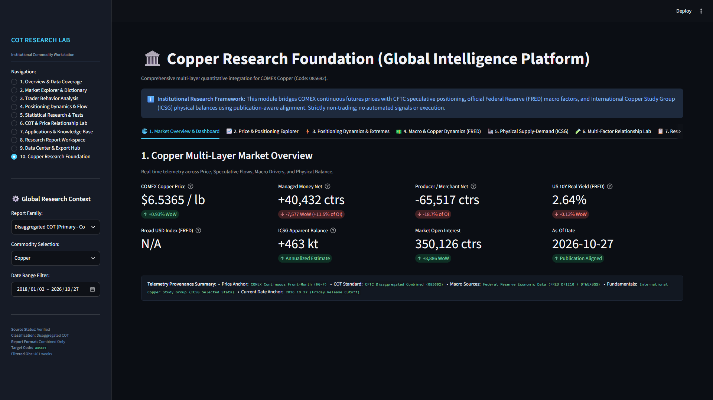
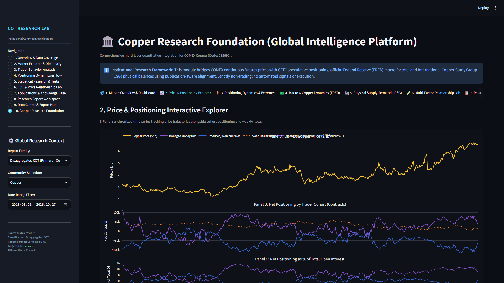
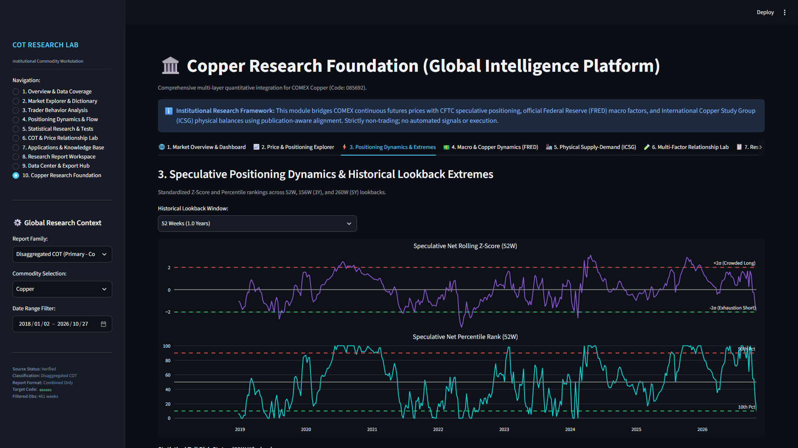
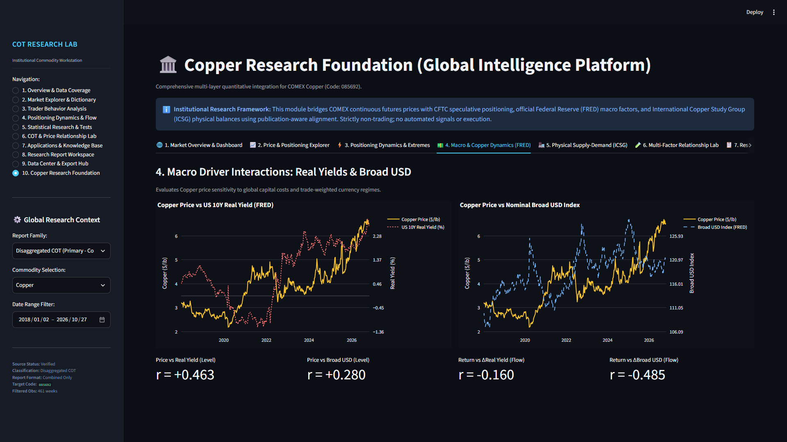
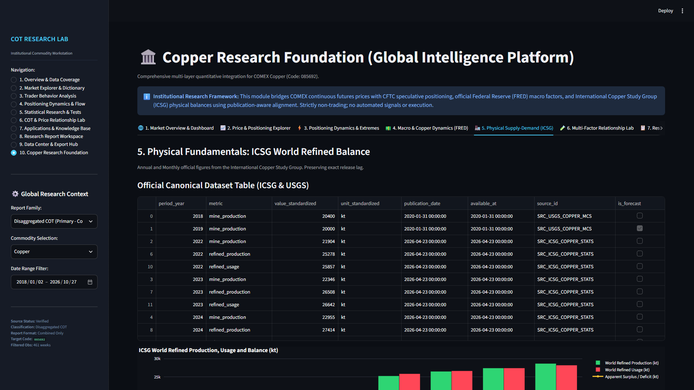
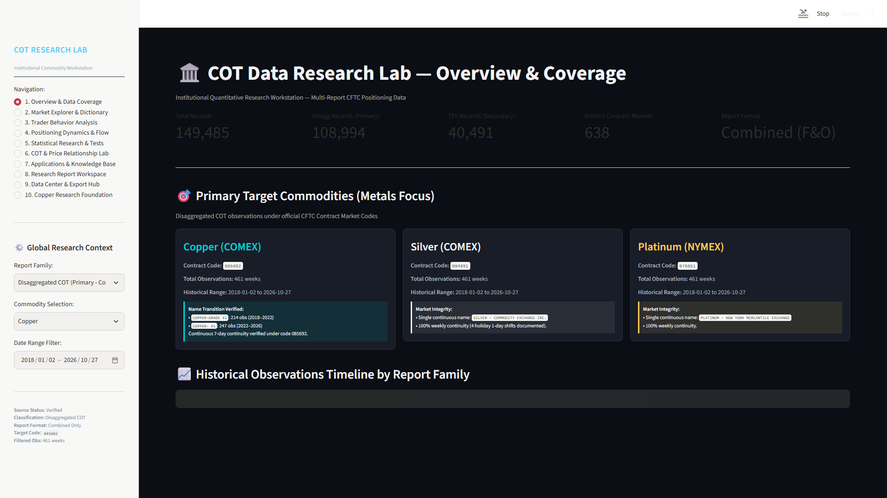
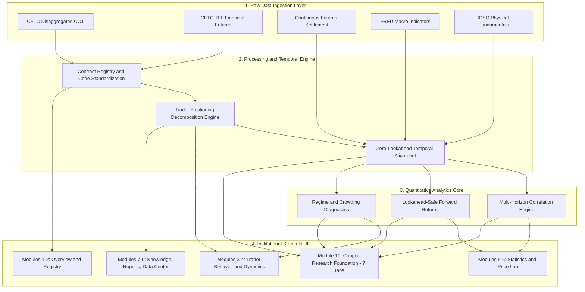

# COT RESEARCH LAB — GLOBAL COMMODITY INTELLIGENCE PLATFORM
### Institutional Quantitative Workstation for Multi-Layer Commodity Research

[](https://www.python.org/downloads/)
[](https://streamlit.io)
[](https://plotly.com/)
[](LICENSE)
[](#data-pipeline--architecture-flow)

---

## 🎬 Live Interactive Interface Demo

The **COT Research Lab** bridges COMEX continuous futures settlement prices with multi-report CFTC positioning, Federal Reserve (FRED) macro liquidity drivers, and International Copper Study Group (ICSG) physical supply-demand balances into a unified, publication-aware research environment.


---

## 📸 Key Research Modules & Interfaces

<div align="center">

### 1. Module 10 — Copper Research Foundation (Market Overview & Real-Time Telemetry)
*Real-time cross-asset telemetry tracking COMEX Copper price, Managed Money Net positioning, Commercial Hedging, US 10Y Real Yield, Broad USD Index, and ICSG Refined Balance.*


### 2. Module 10 — 3-Panel Synchronized Price & Positioning Explorer
*Three-panel synchronized time series displaying historical prices against cohort contract commitments and net % of Open Interest.*


### 3. Module 10 — Positioning Dynamics & Historical Extremes
*Standardized rolling Z-Score (σ) and Percentile rankings across 52W, 104W, 156W, and 260W lookback windows to flag extreme crowding regimes.*


### 4. Module 10 — Macro Driver Interactions (FRED Real Yields & Broad USD)
*Dual-axis price overlay and empirical correlation matrices evaluating Copper sensitivity to global real capital opportunity costs and currency trade regimes.*


### 5. Module 10 — Physical Supply-Demand Balances (ICSG Canonical Integration)
*World refined copper production, usage, and apparent surplus/deficit respecting official historical release lags (`available_at`).*


### 6. Module 1 — Overview & Multi-Report Data Coverage
*Unified registry across Disaggregated COT and Traders in Financial Futures (TFF), highlighting target metals with verified contract continuity.*


</div>

---

## 📌 Problem Statement & Strategic Objectives

### 1. The Commodity Data Fragmentation Challenge
Institutional commodity researchers face significant fragmentation across key data layers:
- **Exchange Price Action:** Daily continuous futures settlement data from COMEX/NYMEX.
- **Regulatory Positioning:** Weekly Commitment of Traders (COT) reports from the Commodity Futures Trading Commission (CFTC).
- **Macroeconomic Liquidity:** Daily inflation-protected yields (`DFII10`) and trade-weighted dollar indices (`DTWEXBGS`) from the Federal Reserve Bank of St. Louis (FRED).
- **Physical Market Fundamentals:** Monthly and annual balance sheets from specialized industry bodies such as the International Copper Study Group (ICSG) and USGS.

Historically, quantitative analysts either analyzed these datasets in isolated silos or used naive date-merges that introduced catastrophic **look-ahead bias**.

### 2. The Publication Lag & Zero-Lookahead Mandate
Market data sources operate on fundamentally different reporting calendars and publication delays:
- **CFTC COT:** Positions are measured at Tuesday's market close (Survey Date / As-of Date), but officially published on Friday afternoon at 15:30 EST (**$T + 3$ days publication lag**).
- **FRED Broad USD Index:** Fed aggregates trade weights across 26 global currency partners, incurring a **2–3 business day compilation lag**.
- **ICSG Fundamentals:** Official refined balances are released with a **60–90 day publication lag**.

> **Zero-Lookahead Guarantee:** Any quantitative test that uses Tuesday's positioning to explain Tuesday's price return commits look-ahead bias. The COT Research Lab strictly enforces **Publication-Aware Alignment**: positioning data is anchored to the Friday publication close (`price_publication`), and all forward return calculations ($1\text{W}, 2\text{W}, 4\text{W}, 8\text{W}, 13\text{W}$) strictly originate *after* the public availability cutoff.

### 3. Institutional Governance Scope
This platform is an analytical, econometric, and diagnostic research workstation.
- ❌ **STRICTLY EXCLUDED:** Buy/sell signals, trade execution, broker APIs, portfolio sizing, automated black-box trading, and investment advisory recommendations.
- ✅ **CORE FOCUS:** Hypothesis testing, empirical return distributions, liquidity tail-risk diagnostics, and cross-asset structural elasticity research.

---

## 🏗️ Data Pipeline & Architecture Flow

The platform implements a four-tier architecture ensuring data lineage, deterministic reproducibility, and zero temporal leakage:



### 📋 End-to-End Data Lineage Breakdown

| Layer | Component | Inputs | Transformation & Outputs | Publication Lag & Constraints |
| :--- | :--- | :--- | :--- | :--- |
| **1. Ingestion** | `data_loader.py` | CFTC Raw Files, Yahoo/Parquet Prices, FRED API, ICSG Parquet | Ingests weekly COT, daily OHLCV prices, macro yields, and annual physical balance sheets into cached DataFrames. | Raw inputs preserved immutably; no synthetic filling. |
| **2. Processing & Alignment** | `metrics_engine.py`<br/>`price_engine.py` | Raw COT & Prices | Computes Net Positioning ($\text{Long} - \text{Short}$), Open Interest standardization ($\% \text{ OI}$), rolling $Z$-scores, and performs `merge_asof(direction='backward')`. | **Zero-Lookahead Mandate:** Anchored to Friday publication cutoff ($T+3$); strictly prevents future information leakage. |
| **3. Quantitative Analytics** | `copper_foundation_service.py` | Aligned Multi-Layer Dataset | Generates multi-horizon forward returns ($1\text{W}$ to $26\text{W}$), Pearson/Spearman correlation matrices, lead-lag shift scans, and extreme crowding diagnostics ($|Z| \ge 2.0\sigma$). | Forward returns strictly originate *after* public report availability. |
| **4. Presentation** | Streamlit Modules `views/` | Processed Statistical Data | Renders interactive Plotly 3-panel overlays, macro dual-axis charts, OLS regression scatterplots, and automated research briefings across 10 modules. | Analytical only; no automated order execution or trade signals. |


---

## 📊 Modules & Capabilities Directory

| Module | Purpose | Key Metrics & Methods |
| :--- | :--- | :--- |
| **1. Overview & Data Coverage** | System-wide observation audit and commodity spotlight. | Record counts, CFTC code validation, 7-day continuity check. |
| **2. Market Explorer** | Interactive dictionary for 100+ commodity & financial contracts. | Exchange classification, reporting history, market lookup. |
| **3. Trader Behavior Analysis** | Granular breakdown of Gross Longs, Gross Shorts, and Spreads. | Managed Money, Producer/Merchant, Swap Dealer, Other Reportables. |
| **4. Positioning Dynamics** | Flow velocity and liquidity acceleration tracking. | Weekly flows ($\Delta$Net), 4W velocity, Crowding ratios. |
| **5. Statistical Research** | Distribution testing and cross-commodity relative analysis. | Skewness, Kurtosis, Top-4/Top-8 concentration ratios. |
| **6. COT & Price Lab** | Empirical lead-lag hypothesis testing and forward returns. | Forward return distributions ($1\text{W}$ to $26\text{W}$), event studies. |
| **7. Knowledge Base** | Methodological institutional handbook with 10 quant topics. | Rationale, formulas, pitfalls, and analytical strengths. |
| **8. Report Workspace** | Automated multi-page institutional briefing generation. | Executive summary generation, export-ready research notes. |
| **9. Data Center** | Data governance, raw inspection, and high-speed export. | CSV / Parquet exports, metadata provenance verification. |
| **10. Copper Foundation** | Comprehensive multi-layer integration for COMEX Copper (085692). | **7 Specialized Sub-Tabs** (Telemetry, Explorer, Dynamics, Macro, ICSG, Lab, Briefing). |

---

## 🗂️ Project Directory Structure

```
cot_research_lab_deploy/
├── run_research_lab.py              # Primary Application Entry Point (10 Modules)
├── start.bat                        # Production Windows One-Click Launcher
├── requirements.txt                 # Application Dependencies
├── README.md                        # Platform Documentation & Architecture Guide
│
├── research_lab/                    # Modular Quantitative Package
│   ├── __init__.py
│   ├── config.py                    # Contract mappings, hex color palette, constants
│   ├── data_loader.py               # Cached ingestion for COT (Disagg/TFF) & continuous prices
│   ├── market_registry.py           # Contract Market Code registry & coverage auditor
│   ├── metrics_engine.py            # Trader decomposition, % OI, and rolling statistics
│   ├── price_engine.py              # Zero-lookahead temporal alignment & forward returns
│   ├── copper_foundation_service.py # Multi-layer integration: Price + COT + FRED + ICSG
│   ├── knowledge_base.py            # Quantitative methodology handbook repository
│   │
│   └── views/                       # Streamlit UI Presentation Modules
│       ├── __init__.py
│       ├── view_overview.py         # Module 1: System Overview
│       ├── view_explorer.py         # Module 2: Market Explorer & Dictionary
│       ├── view_trader_analysis.py  # Module 3: Trader Behavior Analysis
│       ├── view_positioning.py      # Module 4: Positioning Dynamics & Flow
│       ├── view_statistics.py       # Module 5: Statistical Research & Tests
│       ├── view_evaluation.py       # Module 6: COT & Price Relationship Lab
│       ├── view_knowledge.py        # Module 7: Applications & Knowledge Base
│       ├── view_reports.py          # Module 8: Research Report Workspace
│       ├── view_data_center.py      # Module 9: Data Center & Export Hub
│       └── view_copper_foundation.py# Module 10: Copper Research Foundation (7 Tabs)
│
├── data/                            # Verified Research Datasets
│   ├── prices/                      # Daily continuous futures parquet lakehouse
│   ├── macro/                       # FRED daily macro series (DFII10, DTWEXBGS)
│   ├── fundamentals/                # ICSG / USGS canonical supply-demand parquet
│   └── data_tff/                    # Historical Traders in Financial Futures (2010–2026)
│
└── docs/
    └── images/                      # High-resolution screenshots & animated UI demo
        ├── cot_research_lab_demo.gif
        ├── 01_module1_overview.png
        ├── 02_copper_foundation_overview.png
        ├── 03_copper_price_positioning.png
        ├── 04_copper_positioning_dynamics.png
        ├── 05_copper_macro_sensitivity.png
        ├── 06_copper_icsg_fundamentals.png
        └── 07_copper_relationship_lab.png
```

---

## ⚡ Quick Start Guide

### Prerequisites
- Python **3.10** or higher
- Windows 10/11, macOS, or Linux

### Installation

1. **Clone the repository:**
   ```bash
   git clone https://github.com/tramee2109/COT.git
   cd COT
   ```

2. **Create and activate a virtual environment:**
   ```bash
   python -m venv .venv
   # Windows:
   .venv\Scripts\activate
   # macOS / Linux:
   source .venv/bin/activate
   ```

3. **Install dependencies:**
   ```bash
   pip install --upgrade pip
   pip install -r requirements.txt scipy statsmodels
   ```

### Running the Application

* **Option A — One-Click (Windows):**
  Double-click `start.bat`.

* **Option B — Command Line:**
  ```bash
  streamlit run run_research_lab.py --server.port 8501
  ```

Open your browser at **`http://localhost:8501`** to access the research lab.

---

## 🔬 Core Quantitative Formulas

### 1. Positioning Standardization
$$\text{Net Position} = \text{Gross Long} - \text{Gross Short}$$
$$\text{Net Position \% OI} = \left( \frac{\text{Net Position}}{\text{Total Open Interest}} \right) \times 100$$

### 2. Rolling Z-Score ($\sigma$)
$$Z_t = \frac{\text{Net}_t - \mu_{W}(t)}{\sigma_{W}(t)}$$
*Where $W \in \{52, 104, 156, 260\}$ weeks; $|Z| \ge 2.0\sigma$ denotes statistical tail-risk crowding.*

### 3. Historical Percentile Rank
$$\text{Percentile}_t = \frac{\text{Net}_t - \min_{W}(t)}{\max_{W}(t) - \min_{W}(t)} \times 100\%$$

### 4. Zero-Lookahead Forward Return
$$R_{t \to t+h} = \frac{P_{\text{publication}, t+h}}{P_{\text{publication}, t}} - 1$$
*Where $P_{\text{publication}, t}$ is the Friday closing settlement contemporaneous with public release.*

---

## 📜 Regulatory Disclaimer

This software is strictly intended for institutional econometric research, academic inquiry, and educational purposes. Nothing contained herein constitutes investment advice, financial planning, a recommendation to buy or sell securities or commodities futures, or a solicitation of any trading action. All historical backtests, correlations, and event studies represent mathematical observations and do not guarantee future performance.
